  
   
  
  
  
   
  
  <!-- FEATURED_REPOS_START -->

<!-- FEATURED_REPOS_END -->
  

 

### 💫 About Me
- 🔭 **Current Role:** Event Management Head at Idea & Innovation Cell (IIC Club, PMEC)
- 🌱 **Academics:** Computer Science & Engineering (B.Tech) at Parala Maharaja Engineering College (PMEC)
- 💡 **Focus:** AI & ML Development, Web Technologies, and Real-World Problem Solving
- ⚡ **Fun Fact:** I Love Tech and Tech Loves Me
- 📬 **Email:** [prateekmohanty2006@gmail.com](mailto:prateekmohanty2006@gmail.com)

---

### 💻 Tech Stack

  
  
  
  
  
  
  
  
  
  
  
  
  
  
  
  

---

### 🌐 Connect With Me

  
  
  
  
  

  
    
  

